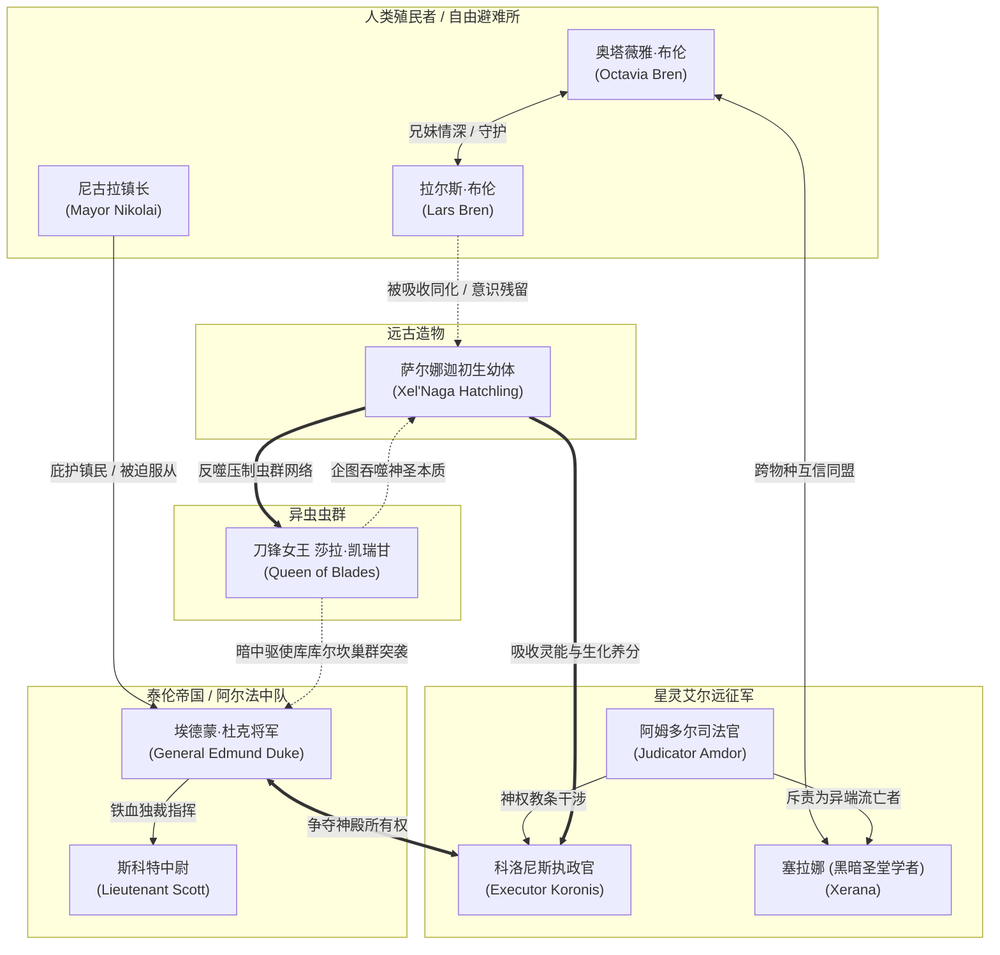

# 《星际争霸：萨尔娜迦之影》角色设定集（Character Settings）

本目录为官方小说《星际争霸：萨尔娜迦之影》（*StarCraft: Shadow of the Xel'Naga*）的全套角色美术与设定集正式资产。各角色文档均包含角色档案、剧情弧光、视频制作视觉锚点（Visual Anchors）、色板规范（Hex 色值）及 AI 生图/生视频模型英文提示词基准。

---

## 👥 角色矩阵与阵营划分

---

## 📁 角色设定文档与人设大看板索引

| 角色文档 | 终版人设图 (Live-Action Model Sheet) | 阵营 | 身份 / 核心定位 | 视觉关键词 |
| :--- | :--- | :--- | :--- | :--- |
| [**奥塔薇雅·布伦**](octavia-bren.md) | [**`octavia-bren-full-sheet.jpg`**](octavia-bren-full-sheet.jpg) | 贝卡·罗殖民者 | 第一女主角、收割机农垦技师、平民领袖 | 工装风镜、等离子焊接枪、赭石色帆布工装 |
| [**拉尔斯·布伦**](lars-bren.md) | [**`lars-bren-full-sheet.jpg`**](lars-bren-full-sheet.jpg) | 贝卡·罗 ➔ 萨尔娜迦共生 | 奥塔薇雅之兄、遗迹触发者、能量受难者 | 少年得意外表、探矿扫描仪、皮革夹克、天蓝幽能 |
| [**埃德蒙·杜克将军**](general-edmund-duke.md) | [**`general-edmund-duke-full-sheet.jpg`**](general-edmund-duke-full-sheet.jpg) | 泰伦帝国阿尔法中队 | 帝国上将、战列巡航舰统帅、冷血军阀 | 满脸刀疤络腮胡、雪茄烈焰、重型红黑动力甲、狼头肩盾 |
| [**塞拉娜**](xerana.md) | [**`xerana-full-sheet.jpg`**](xerana-full-sheet.jpg) | 星灵（黑暗圣堂武士） | 先驱学者、特级侦察机驾驶员、同盟桥梁 | 断神经束、虚空深紫兜帽、翡翠绿曲光战刃、灵能罗盘 |
| [**莎拉·凯瑞甘**](sarah-kerrigan.md) | [**`sarah-kerrigan-full-sheet.jpg`**](sarah-kerrigan-full-sheet.jpg) | 异虫虫群 | 刀锋女王、虫群绝对支配者、幕后棋手 | 六柄骨刃骨翼、昆虫触须发辫、琥珀金瞳、生化骨刺 |
| [**科洛尼斯执政官**](executor-koronis.md) | [**`executor-koronis-full-sheet.jpg`**](executor-koronis-full-sheet.jpg) | 星灵（艾尔圣堂武士） | 远征舰队最高统帅、背负母星沦陷之耻 | 耀目纯金重铠、纯澈卡拉青蓝双眸、双臂光刃、凯达林晶石 |
| [**尼古拉镇长**](mayor-nikolai.md) | [**`mayor-nikolai-full-sheet.jpg`**](mayor-nikolai-full-sheet.jpg) | 贝卡·罗殖民者 | 自由避难所民选镇长、务实小官僚 | 金丝圆框眼镜、褪色海军蓝制服长袍、发光数据板 |
| [**斯科特中尉**](lieutenant-scott.md) | [**`lieutenant-scott-full-sheet.jpg`**](lieutenant-scott-full-sheet.jpg) | 泰伦帝国阿尔法中队 | 杜克副官、陆战队地面战术指挥官 | CMC 动力战甲、C-14 高斯电磁步枪、战术 HUD 目镜 |
| [**阿姆多尔司法官**](judicator-amdor.md) | [**`judicator-amdor-full-sheet.jpg`**](judicator-amdor-full-sheet.jpg) | 星灵（最高议会司法院） | 狂热神官、神权督战代表、教条专制者 | 浮动深紫仪式长袍、赤橙色烈焰双眸、黄金司法权杖 |
| [**萨尔娜迦初生幼体**](xelnaga-entity.md) | *(设定文本已就绪)* | 远古萨尔娜迦 | 沉睡神庙核心、终极宇宙神明雏形 | 超新星白恒星之核、极光星云光翼、悬浮浮石 |

---

## 🎨 场景与视觉基准说明

1. **环境对比**：贝卡·罗恶劣的暗黑沙暴、红土麦浪（Triticale-wheat）与充满毁灭力量的外星科技形成强烈反差。
2. **阵营材质区分**：
   - **平民**：做旧帆布、风化皮革、生锈黄铜与油污。
   - **帝国军**：厚重哑光铸铁、工业螺栓、血红军警条纹涂装。
   - **星灵**：无缝流体金工、凯达林自发光水晶、深邃仪式感丝绸。
   - **异虫**：湿润几丁质甲壳、角质倒钩、脉动肌腱与生化酸液。
   - **萨尔娜迦**：超现实半透明等离子流、黑曜石镜面与反重力场。
